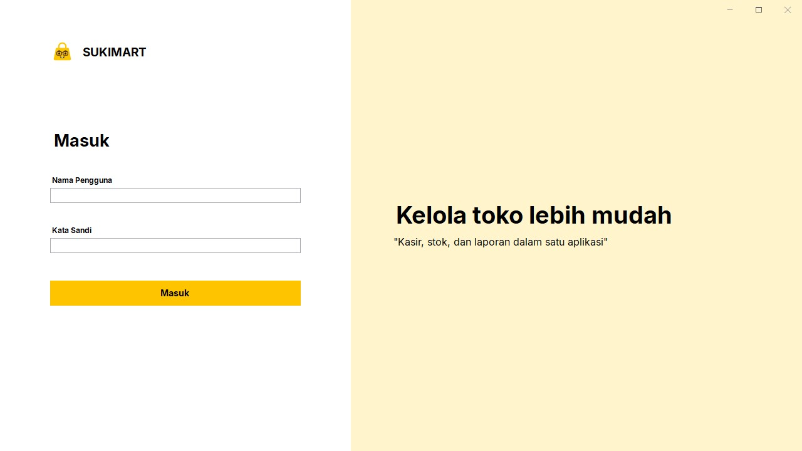
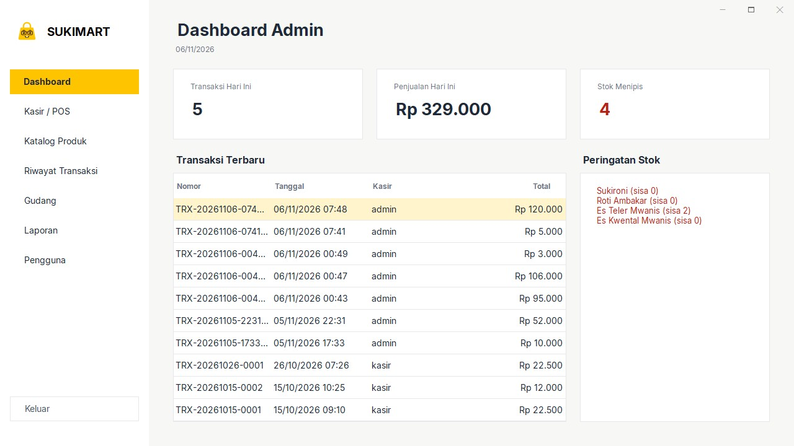

# Sukimart

Sukimart adalah aplikasi desktop kasir (Point of Sale) dan manajemen stok gudang untuk toko ritel kecil, dibuat dengan C# dan Windows Forms. Aplikasi ini menangani transaksi penjualan, pemantauan stok, penambahan stok, akun pengguna dengan kata sandi ter-hash, pembagian hak akses admin dan kasir, riwayat transaksi, serta laporan penjualan. Semua data disimpan secara lokal dalam format JSON, tanpa perlu database terpisah.


## Tangkapan layar

| Masuk | Dashboard Admin |
|---|---|
|  |  |
| **Katalog Produk** | **Manajemen Gudang** |
|  |  |
| **Laporan Penjualan** | |
|  | |

## Memulai

### Kebutuhan

- Windows 10 atau 11
- Salah satu dari:
  - Visual Studio 2022 / 2026 dengan workload **.NET desktop development**, atau
  - [.NET SDK](https://dotnet.microsoft.com/download) versi 8 atau yang lebih baru

Proyek ini menargetkan .NET 8 (`net8.0-windows`) dengan pengaturan `RollForward` bernilai `Major`. Artinya, aplikasi berjalan di komputer yang memiliki .NET 8 Desktop Runtime, dan otomatis memakai .NET 10 jika hanya versi itu yang terpasang.

### Menjalankan dari Visual Studio

1. Clone repositori:
   ```bash
   git clone https://github.com/bajomes/Sukimart.git
   ```
2. Buka `Sukimart.sln` atau `Sukimart.slnx` di Visual Studio.
3. Build solusi lewat **Build > Rebuild Solution** (`Ctrl + Shift + B`) dan pastikan hasilnya `0 Error`.
4. Tekan `F5` untuk menjalankan aplikasi.

### Menjalankan dari .NET CLI

```bash
git clone https://github.com/bajomes/Sukimart.git
cd Sukimart
dotnet build
dotnet run --project Sukimart/Sukimart.csproj
```

## Fitur

- **Masuk berdasarkan peran**: akun admin dan kasir memiliki hak akses yang berbeda. Akun disimpan di `pengguna.json` dengan kata sandi ter-hash.
- **Kelola Pengguna**: lewat menu **Pengguna** di sidebar, admin dapat menambah akun, mengubah peran, mengganti kata sandi, dan menghapus akun.
- **Kasir / POS**: cari produk dengan mengetik nama atau kode, cek stok otomatis, ubah jumlah langsung di tabel keranjang (− / + / ×), hitung total dan kembalian, tombol uang cepat (Uang Pas, +10.000, +20.000, +50.000, +100.000), pengurangan stok otomatis, serta struk transaksi yang bisa dicetak (ukuran kertas 80 mm).
- **Katalog Produk**: tambah, ubah, hapus, dan cari produk lengkap dengan kategori, harga, stok, serta batas minimum stok. Kode barang dijamin unik.
- **Manajemen Gudang**: pantau stok, tampilkan produk yang stoknya menipis, catat stok masuk dan stok keluar beserta keterangannya, serta lihat riwayat perubahan stok.
- **Riwayat Transaksi**: filter berdasarkan rentang tanggal, cari faktur atau kasir, ringkasan omzet, rincian barang per faktur, dan tombol Lihat Struk.
- **Laporan Penjualan**: laporan Hari Ini, Bulan Ini, dan Semua Waktu berisi total pendapatan, jumlah transaksi, item terjual, dan rata-rata per transaksi.
- **Tampilan konsisten**: jendela tanpa bingkai yang bisa digeser, ukuran tetap 1280×720, font Inter yang sudah tertanam di aplikasi, serta gaya tabel dan tombol yang seragam di semua halaman.

## Akun awal

Saat pertama kali dijalankan, aplikasi membuat dua akun berikut. Segera ganti kata sandinya lewat menu **Pengguna** (khusus Admin).

| Peran | Nama Pengguna | Kata Sandi | Hak akses |
|---|---|---|---|
| **Admin** | `admin` | `admin123` | Dashboard Admin, Kasir / POS, Katalog Produk, Riwayat Transaksi, Gudang, Laporan, Pengguna |
| **Kasir** | `kasir` | `kasir123` | Dashboard Kasir, Kasir / POS, Katalog Produk (hanya lihat), Riwayat Transaksi |

## Arsitektur dan penyimpanan data

Data disimpan menggunakan `System.Text.Json`:

- **Lokasi data**: `%LOCALAPPDATA%\Sukimart\Data\`. Saat aplikasi pertama kali dijalankan, folder ini diisi dari `Sukimart/Data/`.
- **Berkas data**:
  - `barang.json`: daftar produk berisi kode, nama, kategori, harga, stok, dan batas minimum stok.
  - `transaksi.json`: daftar transaksi berisi nomor faktur, waktu, kasir, total, uang dibayar, dan kembalian.
  - `detail_transaksi.json`: rincian barang untuk setiap nomor faktur.
  - `riwayat_stok.json`: catatan stok masuk dan stok keluar.
  - `pengguna.json`: akun pengguna berisi nama pengguna, peran, hash kata sandi, dan garam (salt).
- **Keamanan kata sandi**: kata sandi tidak pernah disimpan dalam bentuk teks biasa. Aplikasi memakai PBKDF2 (SHA-256, 100.000 iterasi) dengan garam acak 16 byte untuk setiap akun, dan membandingkan hash secara waktu-konstan.
- **Penyimpanan aman**: data ditulis ke berkas sementara (`.tmp`) terlebih dahulu, lalu menggantikan berkas asli, sehingga data tidak rusak jika aplikasi tertutup mendadak.
- **Ramah Designer**: penyesuaian tampilan dilakukan lewat kelas bantu statis (`UIHelper`, `FontInter`), bukan pewarisan form, sehingga semua form tetap bisa dibuka di WinForms Designer Visual Studio.

## Struktur proyek

```text
Sukimart/
├── Sukimart.sln               # Berkas solusi
├── Sukimart.slnx              # Berkas solusi format baru
├── docs/tangkapan-layar/      # Gambar untuk README
└── Sukimart/
    ├── Data/                  # Data awal JSON
    ├── Fonts/                 # Font Inter beserta lisensinya (OFL)
    ├── Properties/            # Resource aplikasi
    ├── Resources/             # Logo dan ikon
    ├── Models.cs              # Model data (Barang, Transaksi, Pengguna, dll.)
    ├── PenyimpananData.cs     # Baca dan simpan data JSON
    ├── Navigasi.cs            # Sesi pengguna dan perpindahan halaman
    ├── UIHelper.cs            # Geser jendela, gaya tabel, dan garis tepi
    ├── FontInter.cs           # Memuat font Inter dari dalam aplikasi
    ├── KeamananSandi.cs       # Hash dan verifikasi kata sandi
    ├── login.cs               # Halaman masuk
    ├── dashboardadmin.cs      # Dashboard admin
    ├── pengguna.cs            # Kelola pengguna
    ├── dashboardkasir.cs      # Dashboard kasir
    ├── kasir.cs               # Halaman Kasir / POS
    ├── katalog.cs             # Katalog produk
    ├── gudang.cs              # Manajemen gudang
    ├── riwayatstok.cs         # Riwayat stok masuk dan keluar
    ├── laporan.cs             # Laporan penjualan
    ├── riwayattransaksi.cs    # Riwayat transaksi
    └── struk.cs               # Struk transaksi
```

## Lisensi

Kode aplikasi didistribusikan di bawah Lisensi MIT. Lihat `LICENSE` untuk informasi lebih lanjut.

Font Inter dibuat oleh The Inter Project Authors dan didistribusikan di bawah SIL Open Font License 1.1. Lihat `Sukimart/Fonts/OFL.txt`.
